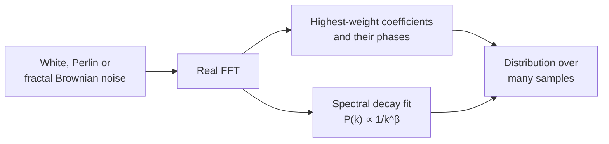
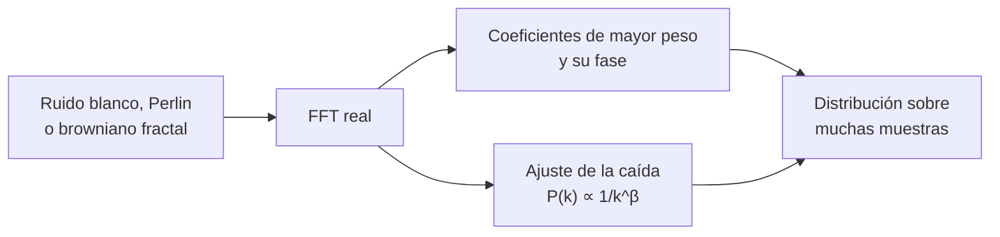

# Quantum Perlin Noise

**[English](#english) · [Español](#español)**

## English

A Python script that **generates white, Perlin and fractal Brownian (fBm) noise** in 1D and 2D and **studies its Fourier spectrum**: which coefficients carry the most weight, what their phases are, how the spectrum falls off with frequency (exponents α and β, dB/octave) and whether all of this repeats from one sample to the next.



### Contents

| File | Purpose |
|---|---|
| `analisis_espectral_ruido.py` | Noise generation, spectral analysis and plots, in 1D and 2D. |

### Requirements

- Python 3 (tested with Python 3.13).
- `numpy`, `matplotlib` (3.4 or later) and `perlin-numpy`.

```bash
pip install numpy matplotlib perlin-numpy
```

### Usage

1. Choose what to analyse in the `CONFIG` dictionary at the top of the script (see [Configuration](#configuration)).
2. Run:

   ```bash
   python analisis_espectral_ruido.py
   ```

3. Numerical results are printed to the console and all figures open at the end. If `GUARDAR_FIGURAS = True`, they are also saved as PNG files in `CARPETA_FIGURAS`.

With the default values it analyses one sample of 1D Perlin noise with 2048 points.

### How it works

#### Noise generation

| Type | How it is generated |
|---|---|
| `blanco` (white) | Independent uniform values in [−0.5, 0.5]. |
| `perlin` | `generate_perlin_noise_2d` from perlin-numpy, with `RESOLUCION` cells per axis. |
| `browniano` (fractal Brownian) | `generate_fractal_noise_2d`: the sum of `OCTAVAS` layers of Perlin noise, each with `LACUNARIDAD` times the frequency and `PERSISTENCIA` times the amplitude of the previous one. |

Each sample has 2^`NUM_BITS` points per axis. In 1D the script uses row 0 of the 2D field and only generates the rows needed to get it, which is much faster than generating the whole field. Sample *i* uses seed *i*, so results are reproducible.

#### Spectrum and highest-weight coefficients

The script computes the real FFT of each sample (`rfft` in 1D, `rfft2` in 2D). Frequency is expressed as k, the number of complete cycles of that component across the signal, or normalised as k/N. From each sample it takes the `COEFS_RELEVANTES` coefficients with the largest magnitude, together with their frequency and phase.

#### Spectral decay

A least-squares line is fitted to the power spectrum on a log-log scale, leaving out k = 0:

P(k) = |c_k|² ∝ 1/k^β

- **β** is the exponent of the power and **α = β/2** the exponent of the magnitude |c_k|.
- The slope in **dB/octave** is −20·log10(2)·α ≈ −6.02·α.
- In 2D the **radial average** of the power is used: coefficients are grouped by |k| rounded to an integer, up to Nyquist.

For reference, white noise gives β ≈ 0 and classical 1D Brownian motion gives β = 2 (the 1/k² curve drawn in green).

#### Distribution over many samples

With `ANALIZAR_DISTRIBUCION = True` the script generates `NUM_MUESTRAS_ANALISIS` samples and pools their highest-weight coefficients, to see whether they always fall at the same frequencies and whether their phases follow any pattern. It also computes β for each sample and reports its mean and standard deviation. Only the top N of each sample is kept, not the full spectra, so thousands of samples can be analysed without running out of memory.

### Configuration

| Parameter | Default | Description |
|---|---|---|
| `TIPOS_RUIDO` | `["perlin"]` | List with `"blanco"`, `"perlin"` and/or `"browniano"`. |
| `DIMENSIONES` | `["1D"]` | List with `"1D"` and/or `"2D"`. Every combination of the two lists is analysed. |
| `NUM_BITS` | `11` | Size: 2^NUM_BITS points per axis (2048). |
| `RESOLUCION` | `64` | Perlin grid cells per axis. |
| `NUM_MUESTRAS` | `1` | Individual samples analysed and plotted (0 to skip). |
| `COEFS_RELEVANTES` | `30` | Number of highest-weight coefficients. |
| `OCTAVAS` | `7` | Layers of Brownian noise. |
| `PERSISTENCIA` | `0.707` | Amplitude factor between octaves. |
| `LACUNARIDAD` | `2` | Frequency factor between octaves. |
| `ANALIZAR_DISTRIBUCION` | `False` | Turns on the analysis over many samples. |
| `NUM_MUESTRAS_ANALISIS` | `100` | Samples in that analysis. |
| `UNIDAD_FRECUENCIA` | `"ciclos"` | `"ciclos"` (k) or `"normalizada"` (k/N). |
| `EXPONENTE_REFERENCIA` | `2` | Exponent p of the 1/k^p reference curve. |
| `DIBUJAR` | `True` | Show the figures. If `GUARDAR_FIGURAS` is also `False`, they are not even created. |
| `GUARDAR_FIGURAS` | `False` | Save the figures as PNG files. |
| `CARPETA_FIGURAS` | `"figuras"` | Folder where they are saved. |

**Size constraint:** perlin-numpy requires 2^`NUM_BITS` to be a multiple of `RESOLUCION` (Perlin) or of `RESOLUCION`·`LACUNARIDAD`^(`OCTAVAS`−1) (Brownian). The script checks this at start-up and, if it fails, says what to change. With the default values, Brownian noise needs `OCTAVAS` ≤ 6.

### Output

On the console, for each sample: magnitude, frequency and phase of the highest-weight coefficients, plus α, β and dB/octave. For the distribution analysis: number of pooled coefficients and mean β ± standard deviation.

Figures (base name `<type>_<dimension>_<bits>bits_reso<res>`, plus `_<oct>oct_persi<p>_lacu<l>` for Brownian noise):

| File | Content |
|---|---|
| `..._muestra<i>_espectro.png` | 1D: signal and full spectrum (log scale) with the top N in red. 2D: noise field, 2D spectrum and top N on the (kx, ky) plane. |
| `..._muestra<i>_caida.png` | Decay fit: magnitude with α, power with β and 1/k^p, and magnitude in dB with the slope in dB/octave. |
| `..._muestra<i>_fases.png` | Top N coloured by phase, and the phase of every coefficient against k. |
| `..._<M>muestras_distribucion.png` | How often each k appears in the top N, magnitudes, phase distribution and phase against k. |
| `..._<M>muestras_beta.png` | Histogram of β over all samples. |

### Notes

- **Conjugate pairs in 2D.** In the ky = 0 row (and ky = N/2), coefficients (kx, ky) and (−kx, ky) are complex conjugates, so the 2D top N can include both even though they carry the same information.

### Author

Mikel Muñoz Vega

---

## Español

Script en Python para **generar ruido blanco, Perlin y browniano fractal (fBm)** en 1D y 2D y **estudiar su espectro de Fourier**: qué coeficientes pesan más, con qué fase, cómo cae el espectro con la frecuencia (exponentes α y β, dB/octava) y si todo eso se repite de una muestra a otra.



### Contenido

| Archivo | Para qué sirve |
|---|---|
| `analisis_espectral_ruido.py` | Generación del ruido, análisis espectral y figuras, en 1D y 2D. |

### Requisitos

- Python 3 (probado con Python 3.13).
- `numpy`, `matplotlib` (3.4 o posterior) y `perlin-numpy`.

```bash
pip install numpy matplotlib perlin-numpy
```

### Uso

1. Elige qué analizar en el diccionario `CONFIG` del principio del script (ver [Configuración](#configuración)).
2. Ejecuta:

   ```bash
   python analisis_espectral_ruido.py
   ```

3. Los resultados numéricos salen por consola y las figuras se abren todas al final. Si `GUARDAR_FIGURAS = True`, también se guardan como PNG en `CARPETA_FIGURAS`.

Con los valores por defecto analiza una muestra de ruido Perlin 1D de 2048 puntos.

### Cómo funciona

#### Generación del ruido

| Tipo | Cómo se genera |
|---|---|
| `blanco` | Valores uniformes independientes en [−0,5, 0,5]. |
| `perlin` | `generate_perlin_noise_2d` de perlin-numpy, con `RESOLUCION` celdas por eje. |
| `browniano` | `generate_fractal_noise_2d`: suma de `OCTAVAS` capas de ruido Perlin, cada una con `LACUNARIDAD` veces la frecuencia y `PERSISTENCIA` veces la amplitud de la anterior. |

Cada muestra tiene 2^`NUM_BITS` puntos por eje. En 1D se usa la fila 0 del campo 2D y solo se generan las filas imprescindibles para obtenerla, lo que es mucho más rápido que generar el campo entero. La muestra *i* usa la semilla *i*, así que los resultados son reproducibles.

#### Espectro y coeficientes de mayor peso

Se calcula la FFT real de cada muestra (`rfft` en 1D, `rfft2` en 2D). La frecuencia se expresa como k, el número de ciclos completos de esa componente a lo largo de la señal, o normalizada como k/N. De cada muestra se toman los `COEFS_RELEVANTES` coeficientes de mayor módulo, con su frecuencia y su fase.

#### Caída del espectro

Se ajusta una recta por mínimos cuadrados al espectro de potencia en escala log-log, sin k = 0:

P(k) = |c_k|² ∝ 1/k^β

- **β** es el exponente de la potencia y **α = β/2** el de la magnitud |c_k|.
- La pendiente en **dB/octava** es −20·log10(2)·α ≈ −6,02·α.
- En 2D se usa la **media radial** de la potencia: se agrupan los coeficientes por |k| redondeado a entero, hasta Nyquist.

Como referencia, el ruido blanco da β ≈ 0 y el movimiento browniano 1D clásico, β = 2 (la curva 1/k² que se dibuja en verde).

#### Distribución sobre muchas muestras

Con `ANALIZAR_DISTRIBUCION = True` se generan `NUM_MUESTRAS_ANALISIS` muestras y se juntan sus coeficientes de mayor peso, para ver si caen siempre en las mismas frecuencias y si sus fases siguen algún patrón. También se calcula β en cada muestra y se da su media y su desviación típica. Solo se guarda el top-N de cada muestra, no los espectros enteros, así que se pueden analizar miles de muestras sin quedarse sin memoria.

### Configuración

| Parámetro | Por defecto | Descripción |
|---|---|---|
| `TIPOS_RUIDO` | `["perlin"]` | Lista con `"blanco"`, `"perlin"` y/o `"browniano"`. |
| `DIMENSIONES` | `["1D"]` | Lista con `"1D"` y/o `"2D"`. Se analizan todas las combinaciones de las dos listas. |
| `NUM_BITS` | `11` | Tamaño: 2^NUM_BITS puntos por eje (2048). |
| `RESOLUCION` | `64` | Celdas de la rejilla de Perlin por eje. |
| `NUM_MUESTRAS` | `1` | Muestras sueltas que se analizan y dibujan (0 para saltárselo). |
| `COEFS_RELEVANTES` | `30` | Número de coeficientes de mayor peso. |
| `OCTAVAS` | `7` | Capas del ruido browniano. |
| `PERSISTENCIA` | `0.707` | Factor de amplitud entre octavas. |
| `LACUNARIDAD` | `2` | Factor de frecuencia entre octavas. |
| `ANALIZAR_DISTRIBUCION` | `False` | Activa el análisis sobre muchas muestras. |
| `NUM_MUESTRAS_ANALISIS` | `100` | Muestras de ese análisis. |
| `UNIDAD_FRECUENCIA` | `"ciclos"` | `"ciclos"` (k) o `"normalizada"` (k/N). |
| `EXPONENTE_REFERENCIA` | `2` | Exponente p de la curva de referencia 1/k^p. |
| `DIBUJAR` | `True` | Mostrar las figuras. Si `GUARDAR_FIGURAS` también es `False`, ni siquiera se generan. |
| `GUARDAR_FIGURAS` | `False` | Guardar las figuras como PNG. |
| `CARPETA_FIGURAS` | `"figuras"` | Carpeta donde se guardan. |

**Restricción de tamaño:** perlin-numpy exige que 2^`NUM_BITS` sea múltiplo de `RESOLUCION` (Perlin) o de `RESOLUCION`·`LACUNARIDAD`^(`OCTAVAS`−1) (browniano). El script lo comprueba al empezar y, si no se cumple, dice qué cambiar. Con los valores por defecto, el ruido browniano necesita `OCTAVAS` ≤ 6.

### Resultados

Por consola, para cada muestra: magnitud, frecuencia y fase de los coeficientes de mayor peso, y α, β y dB/octava. Para el análisis de distribución: número de coeficientes agregados y β medio ± desviación típica.

Figuras (nombre base `<tipo>_<dimensión>_<bits>bits_reso<res>`, más `_<oct>oct_persi<p>_lacu<l>` en el ruido browniano):

| Archivo | Contenido |
|---|---|
| `..._muestra<i>_espectro.png` | 1D: señal y espectro completo (escala log) con el top-N en rojo. 2D: campo de ruido, espectro 2D y top-N en el plano (kx, ky). |
| `..._muestra<i>_caida.png` | Ajuste de la caída: magnitud con α, potencia con β y 1/k^p, y magnitud en dB con la pendiente en dB/octava. |
| `..._muestra<i>_fases.png` | Top-N coloreado por fase y fase de todos los coeficientes frente a k. |
| `..._<M>muestras_distribucion.png` | Cuántas veces aparece cada k en el top-N, magnitudes, distribución de fases y fase frente a k. |
| `..._<M>muestras_beta.png` | Histograma de β sobre todas las muestras. |

### Notas

- **Pares conjugados en 2D.** En la fila ky = 0 (y en ky = N/2), los coeficientes (kx, ky) y (−kx, ky) son conjugados, así que el top-N 2D puede incluir los dos aunque aporten la misma información.

### Autor

Mikel Muñoz Vega
